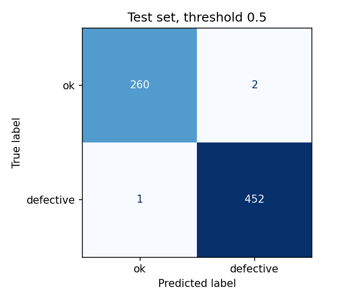
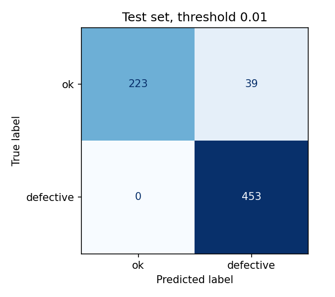
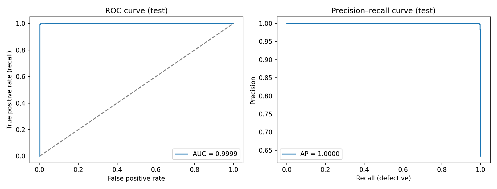
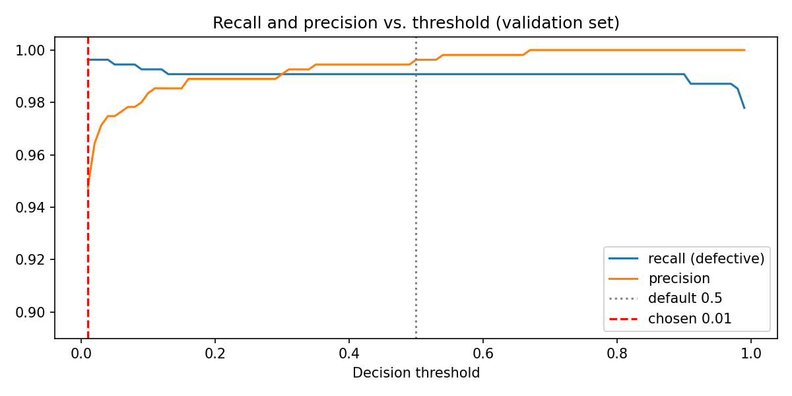
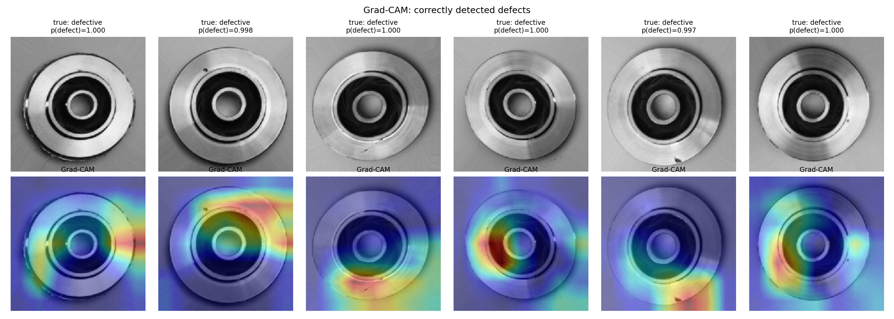
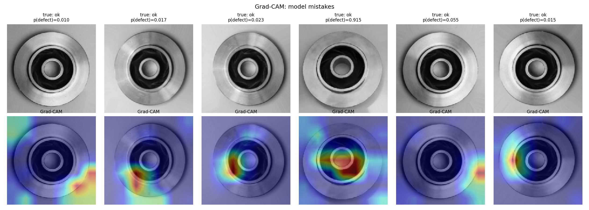

# Casting Defect Detection

**AI-based visual quality inspection for metal casting products: classifying parts as OK or Defective, with explainable results for QC operators.**

> **Status:** model training, evaluation, Grad-CAM, and the demo app are complete. Online deployment of the demo is in progress.

---

## Background

Metal casting is a core process in automotive component manufacturing, from engine parts to **aluminum alloy wheels**, which are commonly produced by *low pressure die casting*. During casting, molten metal can solidify imperfectly and leave defects such as:

- **Porosity / blow holes**: gas trapped inside the metal
- **Shrinkage**: cavities caused by uneven cooling
- **Cracks and pinholes**
- **Surface irregularities**: burrs, flash, or rough surfaces

A defective part that reaches the customer can lead to **product failure, warranty claims, and rejected shipments**. For safety-critical parts like wheels, this risk is unacceptable.

## Problem Statement

In many factories, final inspection is still done **manually by human operators**, a procedure that research describes as time-consuming and error-prone [[1]](#references), with several limitations:

| Problem | Impact |
|---|---|
| **Slow** compared to production speed | Inspection becomes a bottleneck on high-volume lines |
| **Subjective**: results vary between operators and shifts | Inconsistent quality standards |
| **Fatigue**: accuracy drops over long shifts | Defective parts slip through (false negatives) |
| **No data trail**: decisions are not recorded systematically | Hard to analyze defect trends and root causes |

Automated visual inspection with deep learning has become a widely studied alternative for industrial quality control [[2]](#references), including for aluminum castings in the automotive industry [[3]](#references) [[4]](#references).

**Goal:** build a model that can automatically and consistently classify casting products as **OK** or **Defective** from images, and explain *why* it made each decision, so that it can support (not replace) human inspectors.

---

## Approach

```
 Product image ──► Preprocessing ──► CNN Classifier ──► OK / Defective + confidence
                                          │
                                          └──► Grad-CAM heatmap (where the defect is)
                                                     │
                                                     ▼
                                    Web demo for QC operator + inspection log
```

### 1. Dataset
The public **[Real-life Industrial Dataset of Casting Product](https://www.kaggle.com/datasets/ravirajsinh45/real-life-industrial-dataset-of-casting-product)** (Kaggle) [[5]](#references) contains top-view grayscale images of cast **submersible pump impellers**, labeled as:
- `ok_front`: good product
- `def_front`: defective product

> **Note:** the images are pump impellers, not wheels. They are used here because they show **real casting defects** (porosity, blow holes, shrinkage) of the same kind found in cast aluminum wheels. The method is designed to be transferable once wheel-specific images are available.

### 2. Exploratory Data Analysis
- Class distribution and imbalance
- Sample OK vs. defective images
- Image size, color channels, pixel intensity, and duplicate check between train and test

### 3. Modeling
- **Baseline:** a small CNN trained from scratch as a reference point
- **Transfer learning:** ImageNet-pretrained MobileNetV2 [[8]](#references), EfficientNet-B0 [[9]](#references), and ResNet50V2 [[10]](#references), fine-tuned in two phases (frozen backbone, then top layers unfrozen). Transfer learning reduces the amount of training data needed [[11]](#references) and has been applied successfully to casting defect detection [[1]](#references), including on this same dataset [[6]](#references) [[7]](#references)
- **Class weights** to handle the mild class imbalance
- **Data augmentation:** flips, small rotations, light zoom, and contrast changes to simulate real line conditions

### 4. Evaluation from an Industrial Perspective
Accuracy alone is misleading for quality inspection. This project focuses on:
- **Recall on the defective class** as the main metric: a missed defect (*false negative*) is far more costly than re-checking a good part (*false positive*)
- Confusion matrix, precision, recall, F1-score, and AUC
- **Threshold tuning on the validation set** to minimize missed defects, then a single final check on the test set
- Inference time per image, to check whether the model can keep up with production speed

### 5. Explainability (Grad-CAM)
**Grad-CAM** [[12]](#references) heatmaps highlight the region the model considers defective, so QC operators can **verify and trust** the model's decision instead of treating it as a black box.

### 6. Demo Application
A **Streamlit** web app where a user can:
- Upload one or more product images
- Get the result **OK / Defective** with a confidence score
- See the Grad-CAM heatmap
- View an inspection log with total inspected and defect rate, and export it as CSV

---

## Results

### EDA Summary ([notebook](notebooks/01_eda.ipynb))

The dataset contains **7,348 images**, split into **6,633 for training** and **715 for testing**. Defective products slightly outnumber OK products, so the dataset is mildly imbalanced. To prevent the model from favoring the majority class, training uses **class weights**, and evaluation focuses on **recall for the defective class** rather than accuracy alone.

Visually, **OK products** have clean, well-defined outer and inner rims with few scratches or small surface marks. **Defective products** show damage on the outer rim, small chips and scratches across the surface, and **irregular, non-circular shapes**. Most differences between the two classes appear on the **outer and inner rims**, which makes these areas the clearest visual indicators of a defect.

| | |
|---|---|
|  |  |
|  |  |

### Model Comparison ([notebook](notebooks/02_training.ipynb))

Four models were evaluated on the **715-image test set** (453 defective, 262 OK) at the default threshold of 0.5:

| Model | Accuracy | Precision | Recall (defective) | F1 | AUC | Missed defects | False alarms | ms / image | Params (M) |
|---|---|---|---|---|---|---|---|---|---|
| **ResNet50V2 (selected)** | **99.58%** | 99.56% | **99.78%** | **99.67%** | 0.9999 | **1** | 2 | 5.19 | 23.57 |
| MobileNetV2 | **99.58%** | **100%** | 99.34% | **99.67%** | 1.0000 | 3 | **0** | 2.87 | 2.26 |
| EfficientNet-B0 | 99.02% | **100%** | 98.45% | 99.22% | 0.9986 | 7 | **0** | 4.78 | 4.05 |
| Baseline CNN | 83.92% | 83.01% | 93.82% | 88.08% | 0.9105 | 28 | 87 | **0.57** | **0.09** |

*Missed defects and false alarms are derived from recall, precision, and the test set size. Inference time measured on a Google Colab T4 GPU.*


**Key findings**

- **Transfer learning makes a large difference.** All three pretrained models reached about 99% accuracy, compared with 83.9% for the baseline CNN trained from scratch. The baseline let 28 defective parts through and raised 87 false alarms.
- **ResNet50V2 was selected as the best model.** It tied with MobileNetV2 on accuracy and F1, but had the **highest defective recall**, missing only **1 of 453** defective parts. Since a missed defect is costlier than a false alarm, recall decided the tie.
- **MobileNetV2 is the practical alternative for deployment.** It missed 2 more defects than ResNet50V2 but produced **zero false alarms**, while being about **10x smaller** and **1.8x faster**. For an edge device next to a production line, this trade-off may be worth it; the final choice depends on the factory's cost of a missed defect versus a false alarm.

### Evaluation and Grad-CAM ([notebook](notebooks/03_evaluation_gradcam.ipynb))

The decision threshold was tuned on the **validation set** and saved in `models/threshold.json`, so the demo app uses the same decision rule. The confusion matrices compare the default threshold (0.5) with the tuned threshold on the test set.

| | |
|---|---|
|  |  |





Grad-CAM heatmaps show which regions drove the model's decision (red = strong influence). They are used to check whether the model focuses on the outer and inner rims and the visible damage identified in the EDA.





> **Note:** near-perfect scores are common on this dataset, which is clean and was augmented by its author, so similar images can appear in both train and test. Performance on a real production line with different lighting and parts would need to be validated with new data.

---

## Path to Real Production (Wheel Inspection)

This project is a proof of concept. Applying it to an actual alloy wheel production line would require:

1. **Collecting real wheel images** from the line under consistent lighting and camera positioning
2. **Labeling specific defect types** (porosity, shrinkage, cracks, surface defects) with QC experts
3. Moving from classification to **object detection / segmentation** (e.g. YOLO or Mask R-CNN) to locate each defect, as demonstrated for aluminum casting inspection in [[1]](#references) and [[4]](#references)
4. **Edge deployment** (ONNX / TFLite on an industrial PC or edge device) next to the conveyor, where a lighter model such as MobileNetV2 may be preferred
5. **Integration with production systems (MES)** so every inspection result is recorded for traceability and defect trend analysis

---

## Tech Stack

`Python` · `TensorFlow / Keras` · `scikit-learn` · `Grad-CAM` · `Streamlit` · `Hugging Face Hub` · `Google Colab`

## Repository Structure

```
casting-defect-detection/
├── notebooks/
│   ├── 01_eda.ipynb                 # data exploration
│   ├── 02_training.ipynb            # baseline CNN + transfer learning, model comparison
│   └── 03_evaluation_gradcam.ipynb  # confusion matrix, threshold tuning, Grad-CAM
├── app/
│   └── streamlit_app.py             # demo app for QC operators
├── models/                          # resnet50v2.keras (not in Git), threshold.json
├── reports/
│   ├── figures/                     # all charts used in this README
│   ├── model_comparison.csv
│   └── threshold_comparison.csv
├── requirements.txt
└── README.md
```

## How to Run

**Notebooks:** open them in [Google Colab](https://colab.research.google.com), select a **T4 GPU** runtime, and run all cells in order (01, 02, 03). The dataset is downloaded automatically.

**Demo app (locally):**

```bash
git clone https://github.com/gbrlhf/casting-defect-detection.git
cd casting-defect-detection
pip install -r requirements.txt
# put resnet50v2.keras (from notebook 02) and threshold.json (from notebook 03) in models/
streamlit run app/streamlit_app.py
```

The decision threshold defaults to the value tuned on the validation set and can be adjusted in the sidebar.

> The trained ResNet50V2 file is too large for GitHub. The app can download it automatically from a Hugging Face model repo: set `HF_MODEL_REPO` (environment variable or Streamlit secret) to the repo name.

## References

**Casting defect detection and industrial inspection**

1. M. Ferguson, R. Ak, Y.-T. T. Lee, and K. H. Law, "Detection and Segmentation of Manufacturing Defects with Convolutional Neural Networks and Transfer Learning," *Smart and Sustainable Manufacturing Systems*, vol. 2, no. 1, 2018. [doi:10.1520/SSMS20180033](https://doi.org/10.1520/SSMS20180033) · [arXiv:1808.02518](https://arxiv.org/abs/1808.02518)
2. T. Czimmermann et al., "Visual-Based Defect Detection and Classification Approaches for Industrial Applications—A SURVEY," *Sensors*, vol. 20, no. 5, p. 1459, 2020. [doi:10.3390/s20051459](https://doi.org/10.3390/s20051459)
3. D. Mery, "Aluminum Casting Inspection Using Deep Learning: A Method Based on Convolutional Neural Networks," *Journal of Nondestructive Evaluation*, vol. 39, 2020. [doi:10.1007/s10921-020-0655-9](https://doi.org/10.1007/s10921-020-0655-9)
4. D. Mery, "Aluminum Casting Inspection using Deep Object Detection Methods and Simulated Ellipsoidal Defects," *Machine Vision and Applications*, vol. 32, art. 72, 2021.

**Dataset and prior work on the same dataset**

5. R. Dabhi, "Casting product image data for quality inspection" (Real-life Industrial Dataset of Casting Product), Kaggle, 2020. [Link](https://www.kaggle.com/datasets/ravirajsinh45/real-life-industrial-dataset-of-casting-product)
6. M. Habibpour et al., "An Uncertainty-Aware Deep Learning Framework for Defect Detection in Casting Products," 2021. [arXiv:2107.11643](https://arxiv.org/abs/2107.11643)
7. N. Perišić and R. Jovanović, "Application of deep learning in quality inspection of casting products," University of Belgrade, Faculty of Mechanical Engineering, 2022. [Link](https://machinery.mas.bg.ac.rs/handle/123456789/4498)

**Model architectures and methods**

8. M. Sandler, A. Howard, M. Zhu, A. Zhmoginov, and L.-C. Chen, "MobileNetV2: Inverted Residuals and Linear Bottlenecks," *CVPR*, 2018. [arXiv:1801.04381](https://arxiv.org/abs/1801.04381)
9. M. Tan and Q. V. Le, "EfficientNet: Rethinking Model Scaling for Convolutional Neural Networks," *ICML*, 2019. [arXiv:1905.11946](https://arxiv.org/abs/1905.11946)
10. K. He, X. Zhang, S. Ren, and J. Sun, "Identity Mappings in Deep Residual Networks" (ResNetV2), *ECCV*, 2016. [arXiv:1603.05027](https://arxiv.org/abs/1603.05027)
11. J. Yosinski, J. Clune, Y. Bengio, and H. Lipson, "How transferable are features in deep neural networks?," *NeurIPS*, 2014. [arXiv:1411.1792](https://arxiv.org/abs/1411.1792)
12. R. R. Selvaraju et al., "Grad-CAM: Visual Explanations from Deep Networks via Gradient-based Localization," *ICCV*, 2017. [arXiv:1610.02391](https://arxiv.org/abs/1610.02391)

## Acknowledgements

Dataset: *Real-life Industrial Dataset of Casting Product* by Ravirajsinh Dabhi, published on Kaggle. Please refer to the dataset page for its license and terms of use.

## Author

**Gibral Haikal Faiz**, Industrial Informatics Engineering Student, Politeknik Manufaktur Bandung
[LinkedIn](https://www.linkedin.com/in/gibral-haikal-faiz-46449a319/) · [GitHub](https://github.com/gbrlhf)